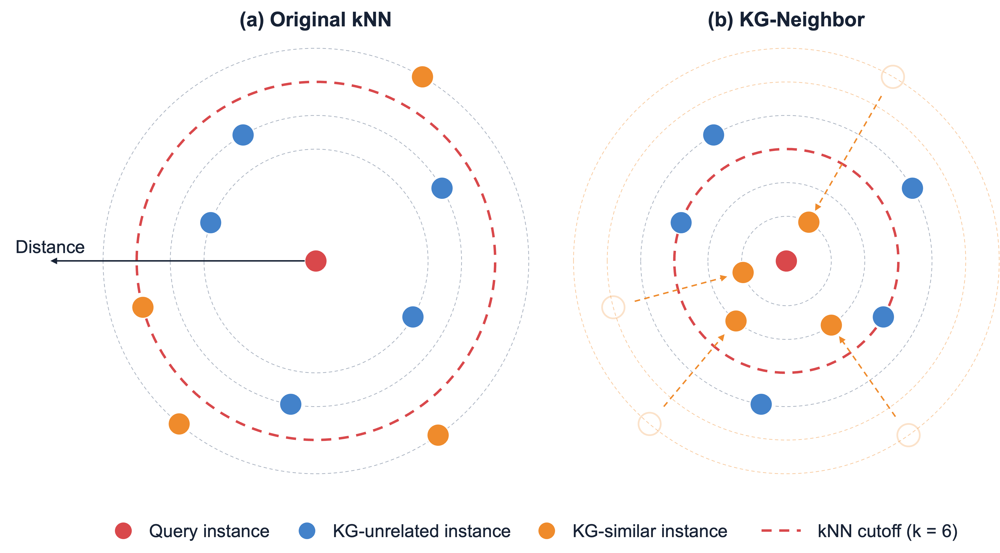
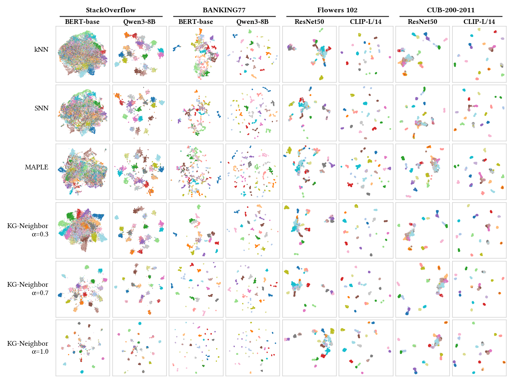

<div align="center">

# KG-Neighbor: Knowledge-Guided Neighborhood Construction for Embedding Visualization

<p>
  
  
  <a href="LICENSE"></a>
</p>

<p>
  <a href="README.md">English</a> | <a href="README_ko.md">한국어</a>
</p>



</div>

This repository contains code for the paper
[KG-Neighbor: Knowledge-Guided Neighborhood Construction for Embedding Visualization](https://arxiv.org/abs/2611.07246) (WSDM 2027 Findings).
The supplementary material of the paper is available at [docs/supplementary.pdf](docs/supplementary.pdf).

## About KG-Neighbor

Neighborhood-based dimensionality reduction methods such as UMAP first find the *k* nearest neighbors (kNN)
of each instance in the input embeddings and connect them into a neighborhood graph. They then optimize a
low-dimensional layout so that connected instances are placed close together and unconnected ones far
apart. In this process, neighbors are determined only by the distances between embedding vectors.
Consequently, when the embedding-based neighborhood graph does not fully reflect relationships in instance
content, the low-dimensional layout may inherit the same limitation.

To address this limitation, KG-Neighbor complements embedding-based neighborhood construction with
relational knowledge derived from instance content and **guides neighbor selection toward instances that
share relational knowledge**. The relational knowledge of each instance, that is, the entities and
relations in its content, is represented as a set of (subject, predicate, object) knowledge graph (KG)
triples, and a separate set is kept for each instance. Triples shared by two instances provide evidence
that the instances are semantically related even when their embedding distance does not fully reflect that
relatedness. KG-Neighbor first quantifies the degree of triple sharing as KG similarity and uses it to
adjust the embedding distance between the two instances. It then reconstructs the top-*k* neighbors from
the adjusted distances. In the paper, the KGs were constructed by using an LLM to extract triples from
instance content.

Improving neighborhood construction does not necessarily eliminate every disagreement between an instance
and its surrounding neighborhood, and such a disagreement does not by itself imply a projection failure. A
residual mismatch is a condition in which the assigned class of an instance differs from its
neighborhood-majority class in a low-dimensional layout. For each residual mismatch, the Instance
Diagnosis Profile (IDP) uses an LLM judge to evaluate independently whether the instance content supports
the assigned class and whether it supports the neighborhood-majority class, and distinguishes four
diagnostic states based on the two judgments: Placement Issue (only the assigned class is supported),
Label Issue (only the neighborhood-majority class is supported), Boundary Case (both are supported), and
Unresolved Case (neither is supported). These states do not establish the cause of a mismatch. They
characterize how the assigned class and the neighborhood-majority class relate to the instance content.



Rows compare kNN, SNN, MAPLE, and KG-Neighbor at `α ∈ {0.3, 0.7, 1}` with the overlap coefficient. SNN and
MAPLE were run with their public implementations and are not part of this repository.

## Installation

To compute embeddings on a GPU, a PyTorch build that matches your CUDA version must be installed in the
new environment before the last command below (`pip install -e ".[all]"`). The code was tested with
`torch 2.9.1+cu126`.

```
git clone https://github.com/selectstar-ai/KG_Neighbor.git
cd KG_Neighbor
conda create --name kg_neighbor python=3.11
conda activate kg_neighbor
pip install -e ".[all]"
```

`all` installs the `embed`, `plot`, and `llm` extras together. You can also install only the ones you
need, for example `pip install -e ".[embed,plot]"`.

To run the tests, install the `dev` extra with `pip install -e ".[dev]"` and run `pytest`.

## Usage

`run_pipeline.py` runs the stages in this order: preprocess → embed → kg_neighbor (with plots) → idp.

### Data Preparation

The data preparation stage (`--preprocess`) converts the source files placed under `data/<dataset>/raw/`
into the layout below, which the pipeline reads. The released KG triples follow the instance ids assigned
at this stage. All classes are kept here; the 20 evaluated classes are sampled at run time
(`--n_classes 20 --class_seed 0`). StackOverflow has exactly 20 classes, so the full dataset is used. For
BANKING77, the public train and test splits are combined before the classes are sampled.

| Dataset | Modality | Instances | Classes | Source |
| --- | --- | --- | --- | --- |
| StackOverflow | text | 20,000 | 20 | [jacoxu/StackOverflow](https://github.com/jacoxu/StackOverflow) titles |
| BANKING77 | text | 13,083 | 77 | [PolyAI-LDN/task-specific-datasets](https://github.com/PolyAI-LDN/task-specific-datasets) |
| CUB-200-2011 | image | 11,788 | 200 | [CUB-200-2011](https://www.vision.caltech.edu/datasets/cub_200_2011/) images + [Reed et al. (2016)](https://github.com/reedscot/cvpr2016) captions |
| Flowers 102 | image | 8,189 | 102 | [Oxford Flowers 102](https://www.robots.ox.ac.uk/~vgg/data/flowers/102/) images + [Reed et al. (2016)](https://github.com/reedscot/cvpr2016) captions |

First download the source files and place them as follows. The sources are linked in the table above.

```
data/
├── stackoverflow/raw/
│   ├── title_StackOverflow.txt                rawText/ of jacoxu/StackOverflow
│   └── label_StackOverflow.txt                rawText/ of jacoxu/StackOverflow
├── banking77/raw/
│   ├── train.csv                              banking_data/ of PolyAI-LDN/task-specific-datasets
│   └── test.csv                               banking_data/ of PolyAI-LDN/task-specific-datasets
├── cub200/raw/
│   ├── CUB_200_2011.tgz                       CUB-200-2011 images
│   └── cvpr2016_cub.tar.gz                    birds data of Reed et al. (2016)
└── flowers102/raw/
    ├── 102flowers.tgz                         Oxford Flowers 102 images
    └── cvpr2016_flowers.tar.gz                flowers data of Reed et al. (2016)
```

If an archive is somewhere else, pass its path with `--image_archive` or `--reed_archive`.

Then run the preprocessing for each dataset:

```
python run_pipeline.py --preprocess --dataset stackoverflow
python run_pipeline.py --preprocess --dataset banking77
python run_pipeline.py --preprocess --dataset flowers102
python run_pipeline.py --preprocess --dataset cub200
```

The converted data is stored in the following layout:

```
data/<dataset>/
├── meta.json                    class names and source
├── texts/sentences.jsonl        {"id", "text", "class_id", "label_name", ["captions", "image_file"]}
└── images/                      image datasets only
```

### KG Construction

KG-Neighbor needs a set of KG triples for each instance and reads them from
`data/<dataset>/kg/triples.tsv`.

```
data/<dataset>/kg/triples.tsv    sample_id <TAB> subject <TAB> predicate <TAB> object
```

The KGs are constructed in three stages, Entity Extraction, Relation Linking, and Critique, and the same
domain-specific entity types, predicate sets, and normalization rules are applied throughout. The prompts
of each stage and the per-dataset schemas are in [`kg_extractor/`](kg_extractor/).

To construct the KGs, create a `data/<dataset>/kg/**/<sample_id>.triples` file for each instance and then
merge the files:

```
python run_pipeline.py --kg_collect --dataset <dataset>
```

### KG-Neighbor Layouts

This stage computes the embeddings (`--embed`) and, for every combination of KG similarity measure and
guidance strength, reconstructs the top-*k* neighbors and generates a UMAP layout (`--kg_neighbor`).

```
python run_pipeline.py --embed --kg_neighbor --dataset stackoverflow --encoder bert_base
```

- `--embed` encodes the texts or images. The encoders are `bert_base` and `qwen3_8b` for text, and
  `resnet50` and `clip_l14` for images. Without `--encoder`, both encoders of the dataset are used.
- `--kg_neighbor` generates a layout for every combination and computes NMI, LT<sub>2D</sub>, and Neighbor
  Retention. The defaults are four KG similarity measures, `α ∈ {0, 0.1, …, 1}`, `--k 15`,
  `--n_classes 20`, and `--seed 0`.
- The plots are drawn after the layouts. `--plot` redraws them from the saved layouts and metrics.

To run a subset, choose the KG similarity measures and the guidance strengths:

```
python run_pipeline.py --kg_neighbor --dataset stackoverflow --encoder bert_base --measures overlap --alphas 0.3 0.7 1.0
```

- `--measures`: any of `jaccard`, `overlap`, `idf_cosine`, and `adamic_adar` (default: all four).
- `--alphas`: guidance strengths between 0 and 1 (default: 0 to 1 in steps of 0.1).
- Saved layouts are reused, and `metric_default.json` holds the measures and guidance strengths of the
  latest run.

### Instance Diagnosis Profile (IDP)

This stage (`--idp`) finds the residual mismatches in the layouts saved by the previous stage, uses an LLM
judge to evaluate separately whether the instance content supports the assigned class and the
neighborhood-majority class, and distinguishes the four diagnostic states.

```
cp .env.example .env    # then set OPENAI_API_KEY
python run_pipeline.py --idp --dataset stackoverflow --encoder qwen3_8b --dry_run
python run_pipeline.py --idp --dataset stackoverflow --encoder qwen3_8b
```

- The layouts examined are kNN and KG-Neighbor with the overlap coefficient. Each instance–class pair is
  judged only once through the Batch API, and the judgment for the same pair is reused across all layouts.
- `--dry_run` counts the new questions without calling the judge. The judge is a paid API.
- The default judge is GPT-5.4, and `--judge anthropic` uses Claude Opus 5.5 instead.
- A judged question is never sent again, and an interrupted run resumes where it stopped.

### Outputs

The results of each stage are stored under `results/<dataset>/`.

```
results/<dataset>/
├── embeddings/<encoder>/          embedding_{vectors,labels,ids}.npy, embedding_meta.json
├── layouts/<encoder>/default/     layout_knn.npy, layout_<measure>_a<alpha>.npy
├── metrics/<encoder>/             metric_default.json (NMI, LT_2D, Neighbor Retention)
├── plot/<encoder>/default/        plot_knn.png, plot_<measure>_a<alpha>.png
├── analysis/<encoder>/default/    analysis_plot_grid.png, analysis_alpha_sweep.png, analysis_retention.png
└── idp/
    ├── idp_questions.json
    └── <judge_model>/             idp_judgments.json, <encoder>/idp_default.json
```

## Citation

If you use this code, please cite the following paper:

```bibtex
@inproceedings{kim2027kgneighbor,
  title     = {KG-Neighbor: Knowledge-Guided Neighborhood Construction for Embedding Visualization},
  author    = {Kim, Chang Won and Lee, Jaewook and Min, Haeun and Jeong, JunNyeong and Sim, Minwoo and Kang, Barom and Jin, Kyohoon},
  booktitle = {Proceedings of the Twentieth ACM International Conference on Web Search and Data Mining (WSDM 2027)},
  year      = {2027},
  location  = {Hong Kong, Hong Kong},
  publisher = {ACM}
}
```

## License

This repository is released under the
[Creative Commons Attribution-NonCommercial-NoDerivatives 4.0 International License (CC BY-NC-ND 4.0)](https://creativecommons.org/licenses/by-nc-nd/4.0/);
see [LICENSE](LICENSE). The datasets are subject to the terms of their original sources.
