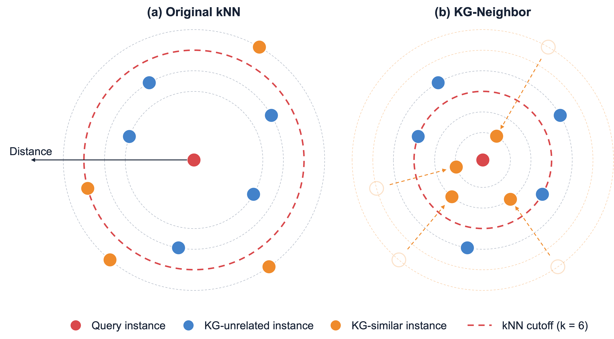
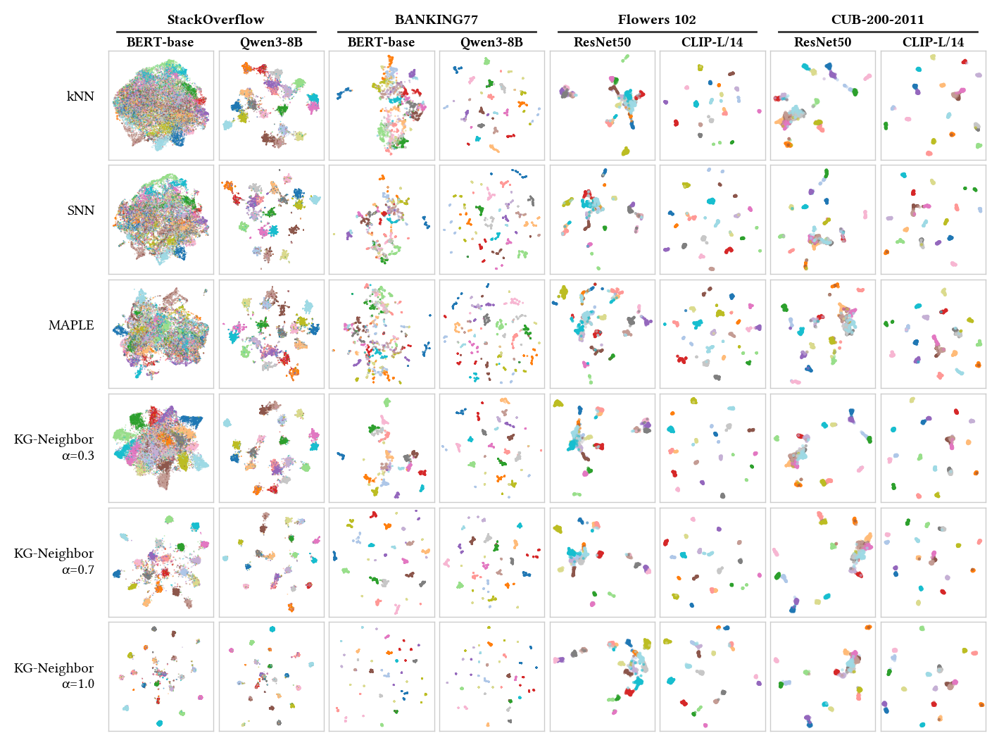

<div align="center">

# KG-Neighbor: Knowledge-Guided Neighborhood Construction for Embedding Visualization

<p>
  
  
  <a href="LICENSE"></a>
</p>

<p>
  <a href="README.md">English</a> | <a href="README_ko.md">한국어</a>
</p>



</div>

이 저장소는 논문 [KG-Neighbor: Knowledge-Guided Neighborhood Construction for Embedding Visualization](https://arxiv.org/abs/2611.07246) (WSDM 2027 Findings)의 코드를 담고 있습니다.
논문의 보충 자료는 [docs/supplementary.pdf](docs/supplementary.pdf)에 있습니다.

## About KG-Neighbor

UMAP 같은 이웃 기반 차원 축소 방법은 먼저 입력 임베딩 벡터에서 인스턴스마다 가장 가까운 *k*개의 이웃(kNN)을 찾아 이웃 그래프를 만듭니다. 그런 다음 이 그래프에서 연결된 인스턴스끼리는 가깝게, 연결되지 않은 인스턴스끼리는 멀게 놓이도록 저차원 배치를 최적화합니다. 이 과정에서 이웃은 임베딩 벡터 사이의 거리만으로 정해집니다. 그래서 임베딩 기반 이웃 그래프가 인스턴스 내용에 있는 관계를 충분히 반영하지 못하면, 저차원 배치도 같은 한계를 물려받을 수 있습니다.

KG-Neighbor는 이 한계를 다루기 위해 임베딩 기반 이웃 구성을 인스턴스 내용에서 얻은 관계 지식으로 보완해, **관계 지식을 공유하는 인스턴스를 이웃으로 선택하도록 유도**하는 방법입니다. 각 인스턴스의 관계 지식은 인스턴스 내용에 있는 개체와 관계를 (subject, predicate, object) 형태로 적은 지식 그래프(KG) triple 집합으로 나타내며, 인스턴스마다 따로 둡니다. 두 인스턴스가 공유하는 triple은 임베딩 거리가 충분히 반영하지 못한 의미적 관련성을 보여 주는 근거가 됩니다. KG-Neighbor는 먼저 두 인스턴스가 triple을 공유하는 정도를 KG 유사도로 계산해 두 인스턴스 사이의 임베딩 거리를 조정합니다. 그런 다음 조정한 거리로 top-*k* 이웃을 다시 구성합니다. 논문에서는 LLM으로 인스턴스 내용에서 triple을 추출해 이 KG를 구성했습니다.

이웃 구성을 개선해도 인스턴스와 주변 이웃 사이의 불일치가 모두 없어지지는 않으며, 이런 불일치가 곧 투영의 실패를 뜻하지는 않습니다. 저차원 배치에서 인스턴스에 부여된 클래스가 이웃의 다수 클래스와 다른 경우를 잔여 불일치(residual mismatch)라고 합니다. Instance Diagnosis Profile(IDP)은 잔여 불일치마다 인스턴스 내용이 부여된 클래스를 지지하는지와 이웃의 다수 클래스를 지지하는지를 LLM 판정자로 따로 평가하고, 두 판정에 따라 Placement Issue(부여된 클래스만 지지), Label Issue(이웃의 다수 클래스만 지지), Boundary Case(둘 다 지지), Unresolved Case(둘 다 지지하지 않음)의 네 진단 상태로 나눕니다. 이 상태들은 불일치의 원인을 확정하지 않으며, 두 클래스가 인스턴스 내용과 어떻게 관련되는지를 나타냅니다.



행은 kNN, SNN, MAPLE, 그리고 overlap coefficient를 쓴 KG-Neighbor(`α ∈ {0.3, 0.7, 1}`)를 비교합니다. SNN과 MAPLE은 각각의 공개 구현으로 실행한 결과이며, 이 저장소에는 포함되어 있지 않습니다.

## Installation

GPU로 임베딩을 계산하려면 아래 마지막 명령(`pip install -e ".[all]"`)을 실행하기 전에, 만든 환경에 CUDA 버전에 맞는 PyTorch가 먼저 설치되어 있어야 합니다. `torch 2.9.1+cu126`에서 실행을 확인했습니다.

```
git clone https://github.com/selectstar-ai/KG_Neighbor.git
cd KG_Neighbor
conda create --name kg_neighbor python=3.11
conda activate kg_neighbor
pip install -e ".[all]"
```

`all`은 `embed`, `plot`, `llm`을 한꺼번에 설치합니다. 필요한 것만 골라 설치할 수도 있습니다 (예: `pip install -e ".[embed,plot]"`).

테스트를 실행하려면 `pip install -e ".[dev]"`로 `dev` 항목을 설치한 뒤 `pytest`를 실행합니다.

## Usage

`run_pipeline.py`는 preprocess → embed → kg_neighbor(플롯 포함) → idp 순서로 단계를 실행합니다.

### Data Preparation

데이터 준비 단계(`--preprocess`)는 `data/<dataset>/raw/`에 받아 둔 원본을 아래와 같이 파이프라인이 읽는 구조로 변환합니다. 공개된 KG triples는 이 단계에서 정해지는 인스턴스 id에 맞춰 구성되어 있습니다. 이 단계에서는 모든 클래스를 남기고, 평가에 쓰는 20개 클래스는 실행할 때 표본으로 뽑습니다 (`--n_classes 20 --class_seed 0`). StackOverflow는 클래스가 20개이므로 전체를 쓰고, BANKING77은 공개된 train과 test 분할을 합친 뒤 클래스를 뽑습니다.

| 데이터셋 | 모달리티 | 인스턴스 | 클래스 | 출처 |
| --- | --- | --- | --- | --- |
| StackOverflow | 텍스트 | 20,000 | 20 | [jacoxu/StackOverflow](https://github.com/jacoxu/StackOverflow) 제목 |
| BANKING77 | 텍스트 | 13,083 | 77 | [PolyAI-LDN/task-specific-datasets](https://github.com/PolyAI-LDN/task-specific-datasets) |
| CUB-200-2011 | 이미지 | 11,788 | 200 | [CUB-200-2011](https://www.vision.caltech.edu/datasets/cub_200_2011/) 이미지 + [Reed et al. (2016)](https://github.com/reedscot/cvpr2016) 캡션 |
| Flowers 102 | 이미지 | 8,189 | 102 | [Oxford Flowers 102](https://www.robots.ox.ac.uk/~vgg/data/flowers/102/) 이미지 + [Reed et al. (2016)](https://github.com/reedscot/cvpr2016) 캡션 |

먼저 원본 파일을 받아 아래 위치에 둡니다. 받는 곳은 위 표의 출처 링크에 있습니다.

```
data/
├── stackoverflow/raw/
│   ├── title_StackOverflow.txt                jacoxu/StackOverflow의 rawText/
│   └── label_StackOverflow.txt                jacoxu/StackOverflow의 rawText/
├── banking77/raw/
│   ├── train.csv                              PolyAI-LDN/task-specific-datasets의 banking_data/
│   └── test.csv                               PolyAI-LDN/task-specific-datasets의 banking_data/
├── cub200/raw/
│   ├── CUB_200_2011.tgz                       CUB-200-2011 이미지
│   └── cvpr2016_cub.tar.gz                    Reed et al. (2016)의 birds data
└── flowers102/raw/
    ├── 102flowers.tgz                         Oxford Flowers 102 이미지
    └── cvpr2016_flowers.tar.gz                Reed et al. (2016)의 flowers data
```

압축 파일이 다른 위치에 있으면 `--image_archive`와 `--reed_archive`로 경로를 지정할 수 있습니다.

그런 다음 데이터셋마다 전처리를 실행합니다.

```
python run_pipeline.py --preprocess --dataset stackoverflow
python run_pipeline.py --preprocess --dataset banking77
python run_pipeline.py --preprocess --dataset flowers102
python run_pipeline.py --preprocess --dataset cub200
```

변환된 데이터는 다음 구조로 저장됩니다.

```
data/<dataset>/
├── meta.json                    클래스 이름과 출처
├── texts/sentences.jsonl        {"id", "text", "class_id", "label_name", ["captions", "image_file"]}
└── images/                      이미지 데이터셋만
```

### KG Construction

KG-Neighbor에는 인스턴스마다 KG triple 집합이 필요하며, `data/<dataset>/kg/triples.tsv`에서 읽습니다.

```
data/<dataset>/kg/triples.tsv    sample_id <TAB> subject <TAB> predicate <TAB> object
```

KG는 Entity Extraction, Relation Linking, Critique의 세 단계로 구성하며, 세 단계에 같은 도메인별 entity 유형, predicate 집합, 정규화 규칙을 적용합니다. 각 단계의 프롬프트와 데이터셋별 스키마는 [`kg_extractor/`](kg_extractor/)에 있습니다.

KG를 구성하려면 인스턴스마다 `data/<dataset>/kg/**/<sample_id>.triples` 파일을 만든 뒤, 아래 명령으로 하나로 묶습니다.

```
python run_pipeline.py --kg_collect --dataset <dataset>
```

### KG-Neighbor Layouts

이 단계는 임베딩을 계산하고(`--embed`), KG 유사도와 안내 강도의 조합마다 top-*k* 이웃을 다시 구성해 UMAP 배치를 만듭니다(`--kg_neighbor`).

```
python run_pipeline.py --embed --kg_neighbor --dataset stackoverflow --encoder bert_base
```

- `--embed`는 텍스트나 이미지를 임베딩합니다. 인코더는 텍스트용 `bert_base`와 `qwen3_8b`, 이미지용 `resnet50`과 `clip_l14`입니다. `--encoder`를 생략하면 데이터셋의 두 인코더를 모두 실행합니다.
- `--kg_neighbor`는 조합마다 배치를 만들고 NMI, LT<sub>2D</sub>, Neighbor Retention을 계산합니다. 기본값은 KG 유사도 네 가지, `α ∈ {0, 0.1, …, 1}`, `--k 15`, `--n_classes 20`, `--seed 0`입니다.
- 배치를 만든 뒤 플롯도 함께 그립니다. `--plot`은 저장된 배치와 지표로 그림만 다시 그립니다.

일부만 실행하려면 KG 유사도와 안내 강도를 지정합니다.

```
python run_pipeline.py --kg_neighbor --dataset stackoverflow --encoder bert_base --measures overlap --alphas 0.3 0.7 1.0
```

- `--measures`: `jaccard`, `overlap`, `idf_cosine`, `adamic_adar` 중에서 고릅니다 (기본값: 네 가지 모두).
- `--alphas`: 0과 1 사이의 안내 강도입니다 (기본값: 0부터 1까지 0.1 간격).
- 저장된 배치는 재사용되고, `metric_default.json`에는 마지막 실행의 유사도와 안내 강도만 남습니다.

### Instance Diagnosis Profile (IDP)

이 단계(`--idp`)는 앞 단계에서 저장한 배치에서 잔여 불일치를 찾고, 인스턴스 내용이 부여된 클래스와 이웃의 다수 클래스를 지지하는지 LLM 판정자로 따로 평가해 네 진단 상태로 나눕니다.

```
cp .env.example .env    # OPENAI_API_KEY 입력
python run_pipeline.py --idp --dataset stackoverflow --encoder qwen3_8b --dry_run
python run_pipeline.py --idp --dataset stackoverflow --encoder qwen3_8b
```

- 대상 배치는 kNN과, overlap coefficient를 쓴 KG-Neighbor입니다. 판정은 인스턴스–클래스 쌍마다 한 번만 Batch API로 요청하고, 같은 쌍의 판정은 모든 배치에서 다시 씁니다.
- `--dry_run`은 판정자를 부르지 않고 새로 보낼 질문 수만 셉니다. 판정자는 유료 API입니다.
- 기본 판정자는 GPT-5.4이며, `--judge anthropic`을 주면 Claude Opus 5.5를 사용합니다.
- 이미 판정한 질문은 다시 보내지 않으며, 중단된 실행은 멈춘 곳부터 이어서 진행합니다.

### Outputs

각 단계의 결과는 `results/<dataset>/` 아래에 저장됩니다.

```
results/<dataset>/
├── embeddings/<encoder>/          embedding_{vectors,labels,ids}.npy, embedding_meta.json
├── layouts/<encoder>/default/     layout_knn.npy, layout_<measure>_a<alpha>.npy
├── metrics/<encoder>/             metric_default.json (NMI, LT_2D, Neighbor Retention)
├── plot/<encoder>/default/        plot_knn.png, plot_<measure>_a<alpha>.png
├── analysis/<encoder>/default/    analysis_plot_grid.png, analysis_alpha_sweep.png, analysis_retention.png
└── idp/
    ├── idp_questions.json
    └── <judge_model>/             idp_judgments.json, <encoder>/idp_default.json
```

## Citation

이 코드를 사용한다면 아래 논문을 인용해 주세요.

```bibtex
@inproceedings{kim2027kgneighbor,
  title     = {KG-Neighbor: Knowledge-Guided Neighborhood Construction for Embedding Visualization},
  author    = {Kim, Chang Won and Lee, Jaewook and Min, Haeun and Jeong, JunNyeong and Sim, Minwoo and Kang, Barom and Jin, Kyohoon},
  booktitle = {Proceedings of the Twentieth ACM International Conference on Web Search and Data Mining (WSDM 2027)},
  year      = {2027},
  location  = {Hong Kong, Hong Kong},
  publisher = {ACM}
}
```

## License

이 저장소는 [CC BY-NC-ND 4.0](https://creativecommons.org/licenses/by-nc-nd/4.0/) (Creative Commons Attribution-NonCommercial-NoDerivatives 4.0 International) 라이선스로 공개됩니다. 전문은 [LICENSE](LICENSE)에 있습니다. 데이터셋은 각 원 출처의 이용 조건을 따릅니다.
